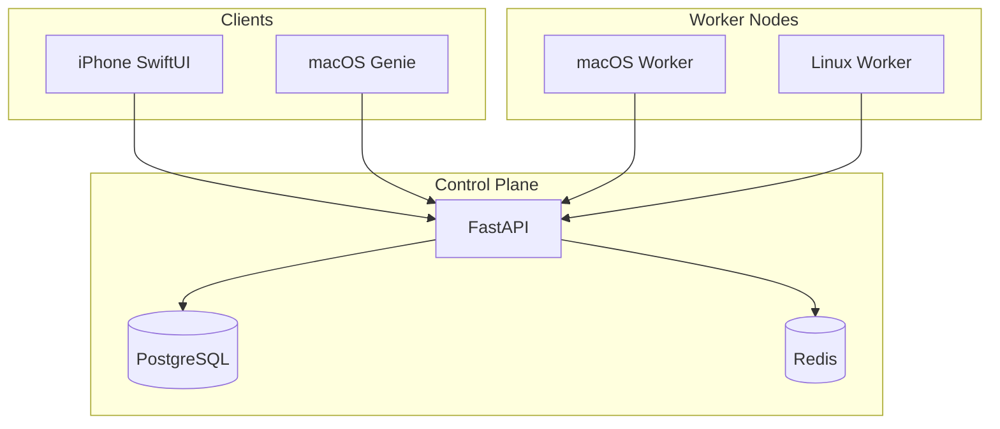

# NOVA

Personal AI operating system for Arth Agrawal — a production-quality nervous-system foundation with cloud-ready control plane, native iOS/macOS clients, and replaceable worker nodes.

## Architecture



See [docs/ARCHITECTURE.md](docs/ARCHITECTURE.md) for full details.

## Quick start

```bash
make bootstrap    # venv, deps, Docker, migrations
make dev          # start API on :8000

# Pair worker (see docs/AUTH_AND_PAIRING.md)
export NOVA_BOOTSTRAP_ADMIN_ENABLED=true
bash scripts/generate-bootstrap-token.sh

make worker       # set WORKER_TOKEN in .env first
make test         # run pytest
```

## Phase 3A — Interactive chat + safe tools

NOVAGenie opens authenticated into interactive chat (`POST /api/v1/chat`). Safe read-only file tools, provider routing foundation, and automation scaffolds — **no shell/write/email/n8n execution**. See [Phase 3A Automation Foundation](docs/PHASE_3A_AUTOMATION_FOUNDATION.md).

```bash
export DEVICE_ID=arth-mac-client
bash scripts/run-novagenie-local.sh
# Try: system status | connected devices | help
```

## Phase 3B — Local-first assistant runtime

NOVA now has persisted chat sessions, local-first provider execution, provider health checks,
approval-gated automation runs, scheduled-task records, companion prompt queuing, and macOS local
SQLite chat restore. Paid providers remain explicit opt-in. See [Phase 3B Runtime](docs/PHASE_3B_RUNTIME.md).

## Daily Driver Chat + Voice

The macOS popup now carries the daily-driver chat flow: real local conversational replies, bounded
conversation memory, structured personal memory, safe personal search, and popup-open wake-word
support. See [Daily Driver Chat, Memory, and Voice](docs/DAILY_DRIVER_CHAT_MEMORY_VOICE.md).

## Slice 2C — Native hardening

Automatic pairing polling, macOS Mission Room WebSocket, **⌃⌥ Space** global hotkey, launch-at-login, launchd worker install, XCTest targets, and [first live demo](docs/FIRST_LIVE_DEMO.md).

```bash
bash scripts/demo_live_nova.sh
make install-worker
python3 scripts/generate_xcode_projects.py
xcodebuild test  # per docs/IOS_APP.md and docs/MACOS_APP.md
```

## Slice 2B — Native live clients

iPhone and macOS apps pair via the API, store tokens in Keychain, stream mission timelines over WebSocket tickets, and support tap-to-talk voice missions. See [Native Client Slice 2B](docs/NATIVE_CLIENT_SLICE_2B.md).

```bash
# Regenerate Xcode projects after adding Swift files
python3 scripts/generate_xcode_projects.py
cd apps/ios && xcodebuild -project NOVA.xcodeproj -scheme NOVA -destination 'platform=iOS Simulator,name=iPhone 17 Pro' build
cd apps/macos && xcodebuild -project NOVAGenie.xcodeproj -scheme NOVAGenie build
```

## Slice 2B — Worker command transport

Redis Streams command dispatch with PostgreSQL authority. See [Scalable Worker Dispatch](docs/SCALABLE_WORKER_DISPATCH.md).

```bash
# Worker uses WS ticket + command_pickup_ack / command_result
make worker
```

Authenticated pairing, durable mission events (PostgreSQL + Redis Streams), worker WebSocket, honest mission queuing.

- [Auth & Pairing](docs/AUTH_AND_PAIRING.md)
- [Realtime Events](docs/REALTIME_EVENTS.md)
- [Worker Connection](docs/WORKER_CONNECTION.md)
- [Phase 3A Automation Foundation](docs/PHASE_3A_AUTOMATION_FOUNDATION.md)
- [Phase 3B Runtime](docs/PHASE_3B_RUNTIME.md)
- [Native Client Slice 2C](docs/NATIVE_CLIENT_SLICE_2C.md)
- [First Live Demo](docs/FIRST_LIVE_DEMO.md)
- [iOS App](docs/IOS_APP.md)
- [macOS App](docs/MACOS_APP.md)
- [Action Button](docs/ACTION_BUTTON.md)
- [Native Client Slice 2B](docs/NATIVE_CLIENT_SLICE_2B.md)
- [Troubleshooting](docs/TROUBLESHOOTING.md)
- [Slice 2A Plan](docs/SLICE_2A_BACKEND_LIVE_NERVOUS_SYSTEM_PLAN.md)

## Stack

| Component | Technology |
|-----------|------------|
| Control plane | Python 3.12, FastAPI, SQLAlchemy 2, Alembic |
| Database | PostgreSQL (pgvector-compatible) |
| Cache | Redis |
| Worker | Python daemon (launchd-managed) |
| iPhone | SwiftUI |
| macOS | SwiftUI menu-bar app |

## Agents

Seven permanent commanders: **NOVA**, **MARS**, **MERCURY**, **JUPITER**, **VENUS**, **SATURN**, **NEPTUNE** — plus functional specialists. See [docs/AGENT_HIERARCHY.md](docs/AGENT_HIERARCHY.md).

## Documentation

- [Architecture](docs/ARCHITECTURE.md)
- [Agent Hierarchy](docs/AGENT_HIERARCHY.md)
- [Device Model](docs/DEVICE_MODEL.md)
- [Configuration](docs/CONFIGURATION.md)
- [Foundation Slice 1 Plan](docs/FOUNDATION_SLICE_1_PLAN.md)
- [ADRs](docs/adr/)

## License

Private — Arth Agrawal.
