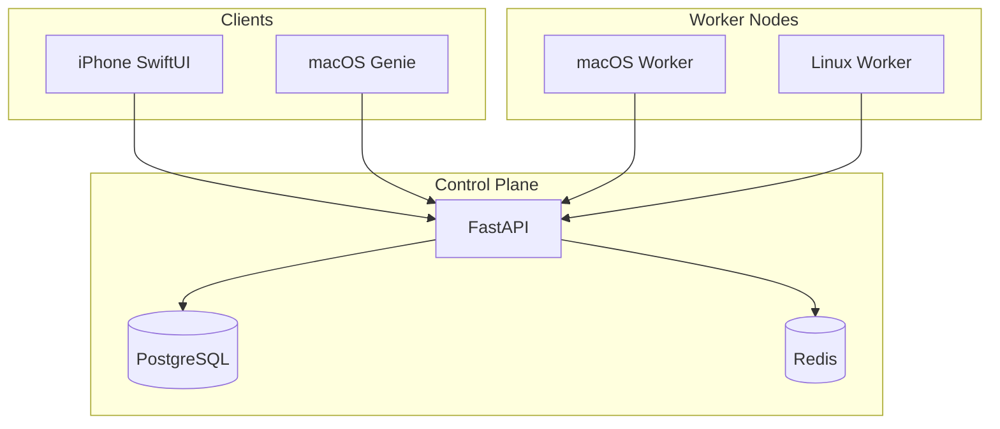

# NOVA

Personal AI operating system for Arth Agrawal — a production-quality nervous-system foundation with cloud-ready control plane, native iOS/macOS clients, and replaceable worker nodes.

## Architecture



See [docs/ARCHITECTURE.md](docs/ARCHITECTURE.md) for full details.

## Quick start

```bash
make bootstrap    # venv, deps, Docker, migrations
make dev          # start API on :8000

# Pair worker (see docs/AUTH_AND_PAIRING.md)
export NOVA_BOOTSTRAP_ADMIN_ENABLED=true
bash scripts/generate-bootstrap-token.sh

make worker       # set WORKER_TOKEN in .env first
make test         # run pytest
```

## Slice 2A — Live backend

Authenticated pairing, durable mission events (PostgreSQL + Redis Streams), worker WebSocket, honest mission queuing.

- [Auth & Pairing](docs/AUTH_AND_PAIRING.md)
- [Realtime Events](docs/REALTIME_EVENTS.md)
- [Worker Connection](docs/WORKER_CONNECTION.md)
- [Troubleshooting](docs/TROUBLESHOOTING.md)
- [Slice 2A Plan](docs/SLICE_2A_BACKEND_LIVE_NERVOUS_SYSTEM_PLAN.md)

## Stack

| Component | Technology |
|-----------|------------|
| Control plane | Python 3.12, FastAPI, SQLAlchemy 2, Alembic |
| Database | PostgreSQL (pgvector-compatible) |
| Cache | Redis |
| Worker | Python daemon (launchd-managed) |
| iPhone | SwiftUI |
| macOS | SwiftUI menu-bar app |

## Agents

Seven permanent commanders: **NOVA**, **MARS**, **MERCURY**, **JUPITER**, **VENUS**, **SATURN**, **NEPTUNE** — plus functional specialists. See [docs/AGENT_HIERARCHY.md](docs/AGENT_HIERARCHY.md).

## Documentation

- [Architecture](docs/ARCHITECTURE.md)
- [Agent Hierarchy](docs/AGENT_HIERARCHY.md)
- [Device Model](docs/DEVICE_MODEL.md)
- [Configuration](docs/CONFIGURATION.md)
- [Foundation Slice 1 Plan](docs/FOUNDATION_SLICE_1_PLAN.md)
- [ADRs](docs/adr/)

## License

Private — Arth Agrawal.
