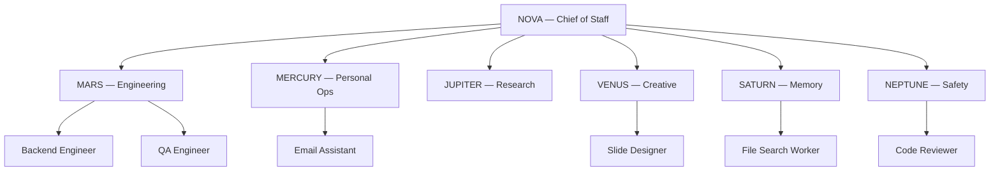

# Agent Hierarchy

NOVA uses seven permanent **commanders** (logical agents) and functional **specialists** (workers). Commanders orchestrate; specialists execute narrow tasks.

## Hierarchy diagram

## Commanders

| ID | Name | Role | Colour Token |
|----|------|------|--------------|
| `nova` | NOVA | Chief of Staff | `nova_blue` |
| `mars` | MARS | Engineering Commander | `mars_red` |
| `mercury` | MERCURY | Personal Operations | `mercury_silver` |
| `jupiter` | JUPITER | Research & Planning | `jupiter_amber` |
| `venus` | VENUS | Creative Commander | `venus_rose` |
| `saturn` | SATURN | Memory & File Search | `saturn_gold` |
| `neptune` | NEPTUNE | Safety & Final Review | `neptune_teal` |

Each commander definition in `config/agents.yaml` includes:

- `id`, `display_name`, `role`, `description`
- `colour_token`, `icon_token`
- `voice_profile_id`, `model_tier`, `status`
- `allowed_tool_categories`

## Specialists

Functional names only — no thematic naming:

| ID | Name | Parent |
|----|------|--------|
| `backend_engineer` | Backend Engineer | MARS |
| `qa_engineer` | QA Engineer | MARS |
| `code_reviewer` | Code Reviewer | NEPTUNE |
| `email_assistant` | Email Assistant | MERCURY |
| `file_search_worker` | File Search Worker | SATURN |
| `slide_designer` | Slide Designer | VENUS |

## Routing

All user requests enter through **NOVA**, which delegates to the appropriate commander. Commanders may further delegate to specialists. **NEPTUNE** reviews sensitive operations requiring approval.

## Model tiers

Defined in `config/models.yaml`:

- **flagship** — complex reasoning (commanders)
- **standard** — routine tasks (specialists)
- **fast** — quick lookups
- **local** — Ollama on worker nodes

API keys are referenced by env var name only — never stored in config or database.
