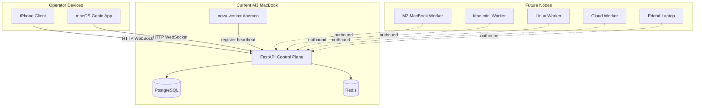
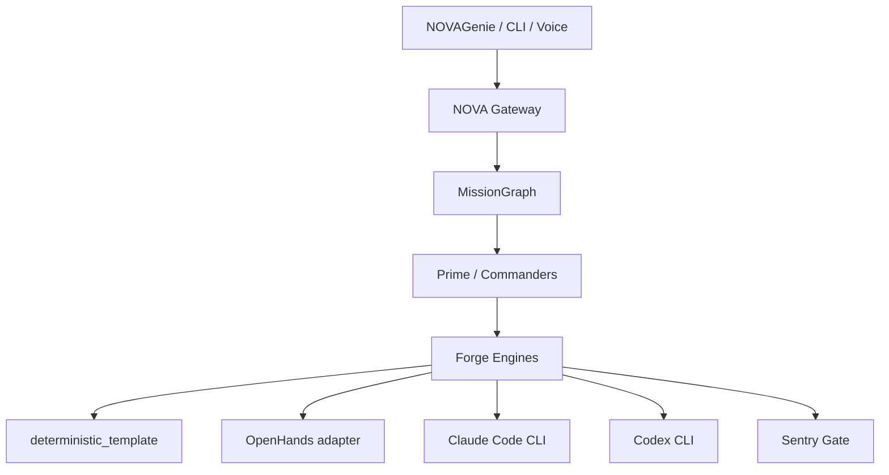
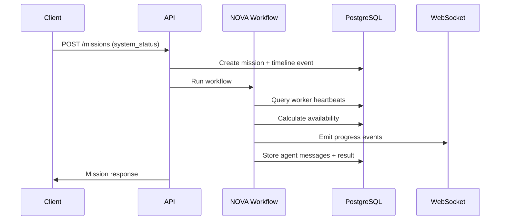

# NOVA Architecture

## Overview

NOVA is a personal AI operating system composed of a **control plane**, **worker nodes**, and **native clients**. The architecture supports adding or replacing devices without changing business logic.

## System diagram

## Components

### Control plane (`apps/api`)

FastAPI service providing:

- Health, readiness, and system status endpoints
- Device and agent registry
- Mission creation and execution
- WebSocket mission progress events
- Audit logging

Runs in Docker Compose alongside PostgreSQL and Redis.

### Worker daemon (`apps/worker`)

Launchd-managed service on each worker node:

- Outbound registration and heartbeat
- Capability reporting (14 typed capabilities)
- Reconnect with exponential backoff
- Health endpoint on port 9100
- **No dangerous tool execution in Slice 1**

Device identity is set via `DEVICE_ID` environment variable — never hardcoded to hardware.

### iPhone client (`apps/ios`)

SwiftUI app with:

- NOVA Orb home screen
- Text chat, Mission Room, Agents, Devices, Settings
- Placeholder STT/TTS interfaces
- Design tokens and agent colour system

### macOS genie (`apps/macos`)

SwiftUI menu-bar app with:

- Floating NOVA Orb placeholder
- Compact and expanded chat
- Voice modes: `prime_only`, `war_room`, `silent_operations`, `briefing`
- Worker health display
- Mock wake-word, STT, TTS provider interfaces

### Core library (`nova_core`)

Shared Python domain logic:

| Package | Purpose |
|---------|---------|
| `models/` | SQLAlchemy ORM, enums, model lanes |
| `mission_graph/` | MissionGraph state machine (LangGraph-style) |
| `forge/` | Forge engine adapters (template, OpenHands, Claude, Codex) |
| `gateway/` | Multi-channel message envelope (OpenClaw-inspired, skills blocked) |
| `voice/` | Wake-word + transcript pipeline |
| `agent_os/` | Prime/Forge/Nexus/Orbit mission execution |
| `schemas/` | Pydantic settings and API DTOs |
| `tools/` | Typed tool extension points |
| `sentry/` | Logging and audit |

## Agent OS stack (investor architecture)

NOVA is the **local command centre** — not a replacement for Claude Code or OpenHands.

- **MissionGraph** records node evidence for every mission
- **Forge** delegates to external coding agents when configured
- **OpenClaw skills are never executed** — gateway pattern only
- **Investor demo fallback:** deterministic templates always work offline

See [EXTERNAL_AGENT_STACK_AUDIT.md](./EXTERNAL_AGENT_STACK_AUDIT.md).

## Data flow: system_status mission

## Design principles

1. **APIs before desktop clicking** — all orchestration goes through the control plane.
2. **Independent worker nodes** — no merged RAM/GPU pools; each node reports its own capabilities.
3. **Replaceable device identity** — `DEVICE_ID` is configurable per node.
4. **Never store plaintext secrets** — API keys via environment only.
5. **Approval-ready structure** — missions support cancellation and approval gates from day one.

## Known limitations (Slice 1)

- No API authentication (dev bearer placeholder)
- Redis connected but not used for pub/sub
- SwiftUI clients use mock data
- No voice capture, Gmail, shell execution, or desktop automation
- Scheduler app is a placeholder

## Next slice

See [FOUNDATION_SLICE_1_PLAN.md](FOUNDATION_SLICE_1_PLAN.md) for Slice 2 scope.
