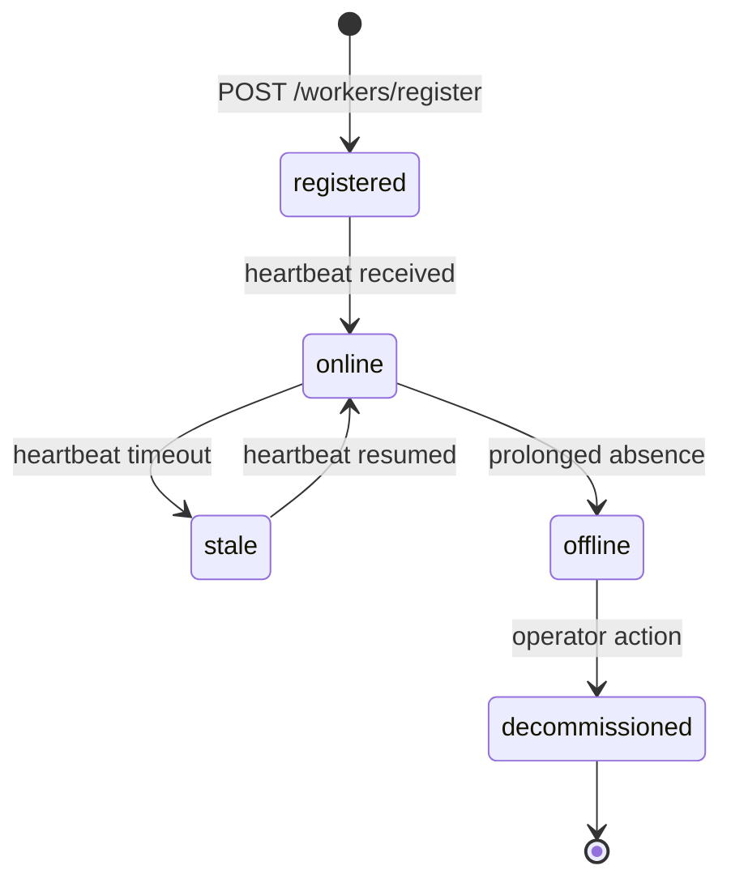

# Device Model

## Principles

1. **Device identity is configurable** — set `DEVICE_ID` in environment, not derived from hardware serial.
2. **Device types are templates** — defined in `config/devices.yaml`, not hardcoded in business logic.
3. **Workers connect outbound** — no inbound ports required on worker nodes.
4. **Independent nodes** — each worker reports its own capabilities; no merged resource pools.

## Device types

| Type | Description | Default capabilities |
|------|-------------|---------------------|
| `macos_worker` | macOS worker daemon | shell, filesystem, ripgrep, git, ... |
| `macos_genie` | macOS menu-bar client | none |
| `iphone_client` | iPhone SwiftUI client | none |
| `linux_worker` | Future Linux worker | shell, filesystem, ripgrep, git |
| `cloud_worker` | Isolated cloud worker | shell, filesystem, ripgrep |
| `friend_laptop` | Restricted friend device | filesystem, ripgrep (read-only) |

## Lifecycle



## Replaceable M3 worker

The current M3 MacBook runs a worker with:

```bash
DEVICE_ID=my-m3-worker
DEVICE_NAME="M3 MacBook Worker"
DEVICE_TYPE=macos_worker
make worker
```

When replacing with a recovered M2 or Mac mini:

1. Install NOVA repo and worker on the new machine
2. Set a **new** or **reused** `DEVICE_ID`
3. Run `scripts/worker/install.sh` for launchd
4. Old device can be decommissioned via future admin API

Business logic never references "M3" — only device IDs and types.

## Friend device pairing (future)

`config/devices.yaml` defines pairing policy:

- `require_approval: true`
- `token_ttl_hours: 24`
- `max_devices_per_user: 10`

Friend laptops get `friend_laptop` type with restricted capabilities. Slice 2 will implement pairing tokens and Keychain storage on clients.

## Heartbeat model

Workers send heartbeats every 30 seconds (configurable). The control plane records each heartbeat in `device_heartbeats` and updates `devices.last_seen_at`.

Stale threshold: 90 seconds for `macos_worker` type.

## Capability reporting

14 typed capabilities (enum in `nova_core/models/enums.py`):

`shell`, `filesystem`, `spotlight`, `ripgrep`, `git`, `github_cli`, `codex`, `cursor`, `ollama`, `browser`, `applescript`, `screenshot`, `desktop_automation`, `ppt_render`

Dangerous capabilities are detected but **not executed** in Slice 1.
