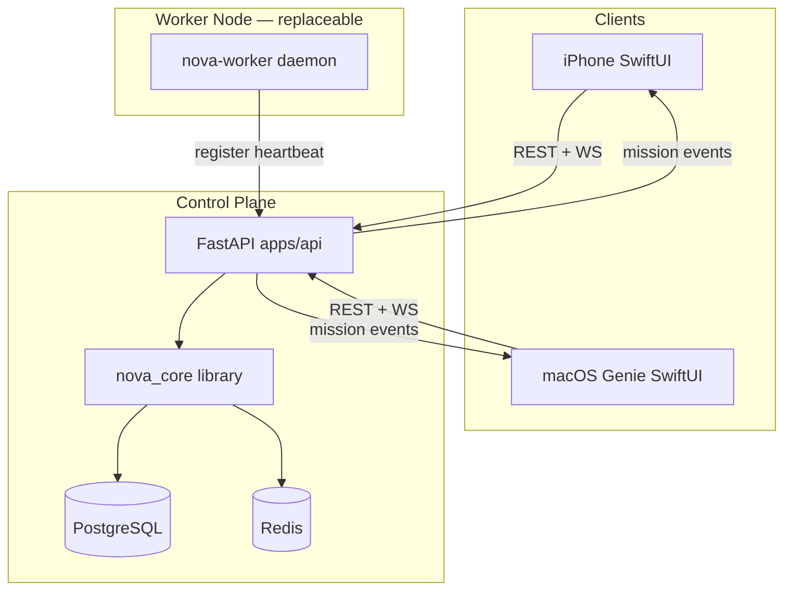

# Foundation Slice 1 — Implementation Plan

## Assumptions

1. **Greenfield repository** — only an empty README and `docs/` exist; no prior code to migrate.
2. **Single operator** — Arth Agrawal is the sole user; multi-tenant auth is deferred but schema includes `users`.
3. **Local-first development** — Docker Compose runs PostgreSQL (pgvector-compatible) and Redis on the M3 MacBook; production deployment is out of scope for Slice 1.
4. **No LangGraph yet** — one durable mission (`system_status`) does not justify LangGraph overhead; a typed workflow interface in `nova_core/workflows/` is LangGraph-ready (see ADR-0003).
5. **SwiftUI projects are structurally valid** — Xcode projects with source files and previews; no App Store signing or TestFlight in this slice.
6. **Worker runs on the same machine as dev** — registration uses configurable device identity, not hardcoded hardware IDs.
7. **Secrets via environment** — `.env` for local dev; no plaintext secrets in DB or config files.
8. **iPhone talks to API over HTTP/WebSocket** — localhost or LAN IP; no push notifications yet.

## Minimal Clean Architecture — Foundation Slice 1



### Layer boundaries

| Layer | Location | Responsibility |
|-------|----------|----------------|
| **Transport** | `apps/api/` | HTTP routes, WebSocket, DI wiring, no business logic |
| **Domain** | `nova_core/` | Models, schemas, workflows, agents, tools interfaces |
| **Persistence** | `nova_core/models/`, `infra/migrations/` | SQLAlchemy ORM, Alembic |
| **Config** | `config/*.yaml`, `nova_core/schemas/settings.py` | Typed settings, agent registry |
| **Worker** | `apps/worker/` | Outbound client, heartbeat, capability probe |
| **Clients** | `apps/ios/`, `apps/macos/` | SwiftUI shells, networking, design tokens |

### Dependency direction

```
apps/api → nova_core → (stdlib, sqlalchemy, pydantic)
apps/worker → nova_core
tests → nova_core, apps/api, apps/worker
```

Clients depend on API contracts only (OpenAPI-shaped DTOs in Swift).

## Tradeoffs

| Decision | Choice | Rationale | Cost |
|----------|--------|-----------|------|
| Workflow engine | Custom typed runner, not LangGraph | One mission; avoids new dep and ops surface | Must wrap in LangGraph adapter later |
| Monorepo Python package | Single `nova_core` + thin apps | Shared types between API and worker | Larger import graph; mitigated by subpackages |
| SQLAlchemy sync + async | Async SQLAlchemy in API | FastAPI native async | Worker uses sync client for simplicity |
| Redis in Slice 1 | Connection + health only | Required for future pub/sub WS fan-out | Unused capacity until Slice 2 |
| SwiftUI without SPM backend | Xcode projects in-repo | Native Apple toolchain expectation | CI needs macOS runner for builds |
| Device identity | Configurable UUID slug, not serial | Replaceable M3 / friend laptop | Operator must set `DEVICE_ID` on new hardware |
| Idempotency | Header `Idempotency-Key` on mission create | Safe retries from clients | Keys stored; cleanup job deferred |

## Implementation checklist

### Phase A — Python foundation
- [x] `pyproject.toml`, Ruff, mypy, pytest config
- [x] `nova_core/schemas/settings.py` — typed settings from env + YAML
- [x] `nova_core/models/` — all 12 tables + enums
- [x] Alembic initial migration
- [x] `config/agents.yaml`, `models.yaml`, `voices.yaml`, `devices.yaml`, `policies.yaml`
- [x] `.env.example`

### Phase B — Control plane API
- [x] Structured logging, startup validation
- [x] Health, readiness, system status endpoints
- [x] Devices list, agents list
- [x] Mission create + detail + WebSocket events
- [x] `system_status` workflow with timeline + WS progress
- [x] Audit event helper
- [x] Typed API errors

### Phase C — Worker
- [x] Registration client, heartbeat loop, capability reporting
- [x] Reconnect with exponential backoff
- [x] Health endpoint, graceful shutdown
- [x] launchd plist template + install/uninstall scripts

### Phase D — Infrastructure
- [x] Docker Compose (pgvector Postgres + Redis)
- [x] Makefile targets
- [x] bootstrap, doctor, start, stop scripts

### Phase E — Native clients
- [x] iOS SwiftUI — Orb, chat, Mission Room, Agents, Devices, Settings
- [x] macOS SwiftUI — menu bar, Orb, chat, voice modes, worker health

### Phase F — Quality
- [x] Test suite (health, readiness, config, models, missions, worker, audit)
- [x] Documentation (README, ARCHITECTURE, ADRs, etc.)
- [x] Ruff, mypy, pytest green

## Exact next slice (Slice 2)

**Mission execution + real worker tools (read-only)**

- Wire LangGraph adapter behind `nova_core/workflows/` interface
- Implement read-only filesystem + ripgrep tool stubs on worker
- Mission Room live updates from Redis pub/sub
- macOS genie → API authentication (device pairing token)
- iPhone onboarding → register device + store token in Keychain
- Approval flow UI (create approval on sensitive tool category)
- Email assistant specialist scaffold (no Gmail OAuth yet)

## Known limitations (Slice 1)

- No authentication on API (dev-only bearer placeholder)
- No Gmail, voice capture, desktop automation, or shell execution
- Redis connected but not used for pub/sub yet
- Scheduler app is a placeholder directory
- SwiftUI apps use mock/preview data; no live API binding in production builds
- Single-user seed data only
