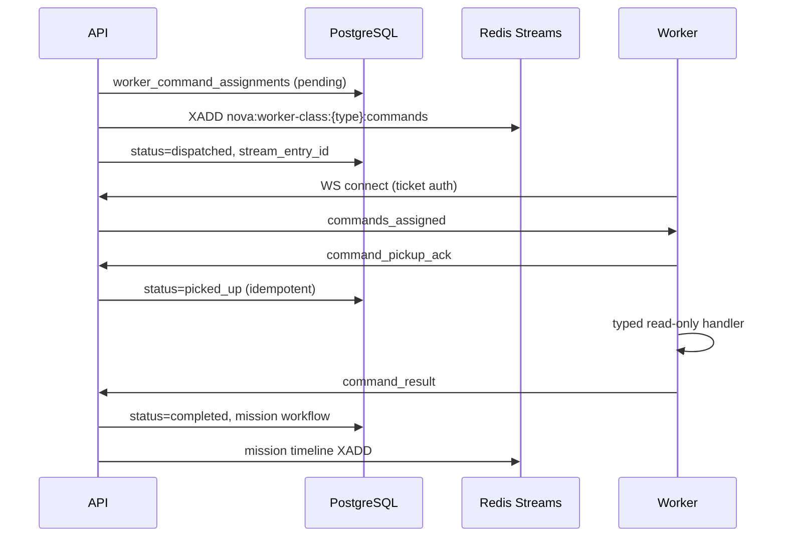

# Scalable Worker Dispatch

Slice 2B Milestone A adds **Redis Streams-backed worker command transport** with **PostgreSQL as the durable source of truth**.

## Architecture



## Durable state (`worker_command_assignments`)

| Field | Purpose |
|-------|---------|
| `command_id` | Primary idempotency key |
| `mission_id` | Optional linked mission |
| `command_type` | Typed read-only command |
| `routing_mode` | `device` or `worker_class` |
| `target_device_id` / `target_worker_class` | Routing targets |
| `status` | `pending` → `dispatched` → `picked_up` → `completed` / `failed` |
| `stream_key` / `stream_entry_id` | Redis transport reference |
| `attempt_count` / `max_attempts` | Bounded retry |

Mission queue rows (`queued_missions`) remain linked via `command_id` for pickup acknowledgement.

## Redis Streams (transport only)

- Per device: `nova:worker:{device_id}:commands`
- Per class: `nova:worker-class:{worker_class}:commands`

If Redis is unavailable, assignments stay in PostgreSQL with `stream_entry_id` null and timeline reports **degraded** streaming — same honesty model as mission events.

## Read-only commands

| Command | Handler output |
|---------|----------------|
| `system_status` | Hostname, OS, arch, uptime, capabilities |
| `hostname` | Node name |
| `uptime` | Uptime seconds |
| `operating_system_version` | Platform string |
| `cpu_architecture` | Machine arch |
| `configured_capabilities` | Capability report |

No shell execution. Dangerous tools remain disabled in policy.

## Recovery

| Scenario | Behavior |
|----------|----------|
| API restart | Pending/dispatched rows survive in PostgreSQL |
| Worker reconnect | `pending_commands_for_worker` re-dispatches and notifies over WS |
| Duplicate pickup | Same `command_id` → single `picked_up` transition |
| Duplicate result | Completed assignment ignores repeat results |
| Stale assignment | After `stale_assignment_seconds`, reset to `pending` and re-dispatch |
| Revoked worker | No new commands; unacknowledged queue rows released |

## WebSocket messages

**Server → worker:** `commands_assigned`, `missions_assigned` (legacy pickup path)

**Worker → server:** `command_pickup_ack`, `command_result`, `mission_pickup_ack`

## Policy (`config/policies.yaml`)

```yaml
worker_dispatch:
  stale_assignment_seconds: 300
  max_command_attempts: 3
```

## Multi-replica API

Any API instance may `XADD` to Redis. Workers read streams and acknowledge on any connected instance. PostgreSQL assignment state prevents duplicate side effects.
