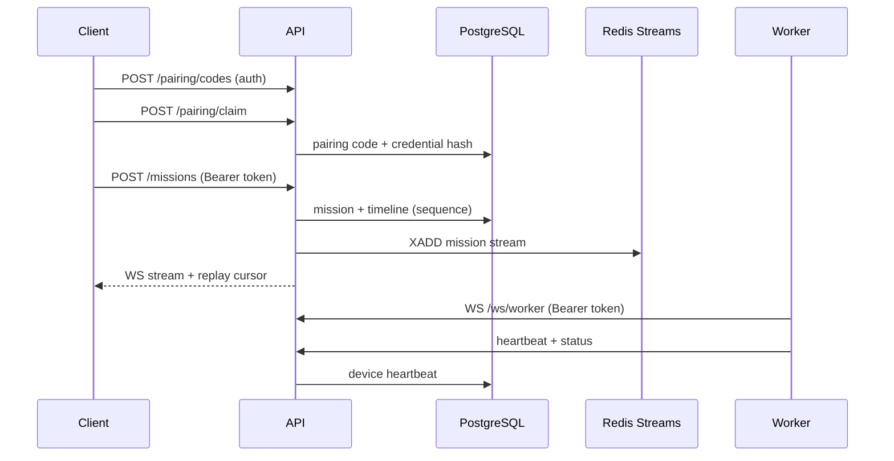

# Slice 2A — Backend Live Nervous System Plan

## Assumptions

1. **Branch:** `feat/live-nervous-system` from approved foundation `cacf589`.
2. **Native clients deferred to Slice 2B** — backend + worker only; no Xcode builds required.
3. **Single operator** — Arth; bootstrap-admin env flag for dev pairing.
4. **Token pepper required in production** — `NOVA_TOKEN_PEPPER` env var; dev default allowed in test.
5. **Redis optional at runtime** — PostgreSQL is source of truth; degraded mode when Redis down.
6. **Worker execution remains read-only** — no shell or dangerous tools.
7. **Slice 2B** will wire iPhone/macOS clients to pairing + authenticated WebSocket.

## Architecture

## Tradeoffs

| Decision | Choice | Cost |
|----------|--------|------|
| Token storage | SHA-256 + pepper, prefix lookup | Not bcrypt — tokens are high-entropy random |
| Idempotency | Scoped table, fingerprint conflict detection | Migration drops global unique on missions |
| Event transport | PG durable + Redis Streams | Dual-write complexity |
| Worker transport | WebSocket primary, REST heartbeat fallback | Two paths to maintain |
| Rate limiting | In-memory sliding window (dev/single-node) | Not distributed — OK for Slice 2A |
| Mission queue | Status + honest message, pickup on worker connect | No full job runner yet |

## Implementation checklist

- [x] Auth models: pairing codes, credentials, sessions, revocations
- [x] Token hash/validate/rotate/revoke
- [x] Pairing endpoints + bootstrap admin
- [x] Scoped idempotency with fingerprint
- [x] Timeline sequence IDs + Redis Streams
- [x] Authenticated REST + WebSocket
- [x] Worker WebSocket + reconnect + status
- [x] Queued mission when worker offline
- [x] Policy config tightening
- [x] Migration 0002
- [x] Tests + docs + ADRs

## Slice 2B (next)

- iPhone/macOS live API binding, Keychain token storage
- Mission Room WebSocket UI
- Read-only filesystem/ripgrep tool stubs on worker
