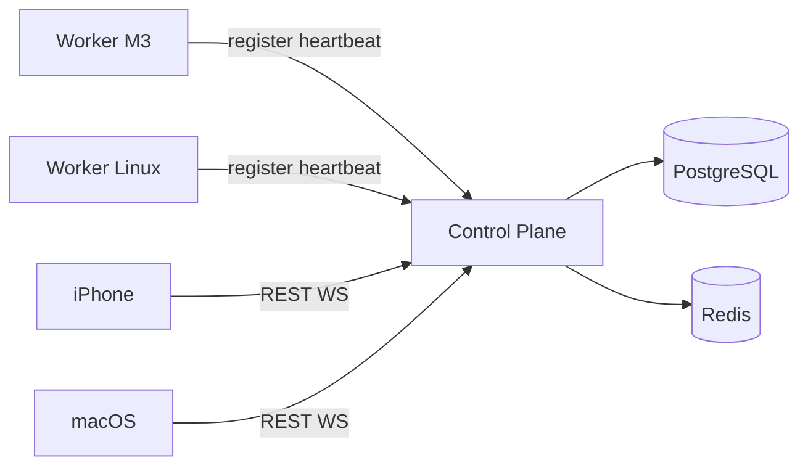

# ADR 0001: Control Plane / Worker Separation

## Status

Accepted — Foundation Slice 1

## Context

NOVA must run across multiple devices: an iPhone client, a macOS genie app, and one or more worker nodes (MacBook, Mac mini, Linux, cloud). Business logic must not assume a single machine or hardcode the current M3 MacBook.

## Decision

Separate the system into:

1. **Control plane** (`apps/api`) — FastAPI service with PostgreSQL, Redis, missions, agents, audit. Runs wherever the operator hosts it (initially the M3 MacBook via Docker Compose).
2. **Worker nodes** (`apps/worker`) — Outbound-only daemons that register, heartbeat, and report capabilities. Each worker has a configurable `DEVICE_ID` set via environment.
3. **Clients** (`apps/ios`, `apps/macos`) — Native SwiftUI apps that talk to the control plane over HTTP/WebSocket.

Workers never expose inbound ports to the internet; they connect outbound to the control plane.

## Consequences

**Positive:**
- Any device can be added, replaced, or removed without changing control-plane code.
- Friend laptops and cloud workers can run restricted capability sets.
- Independent worker nodes — no merged RAM/GPU pools.

**Negative:**
- Worker must reach control plane over network (LAN or VPN initially).
- Tool execution latency includes network hop until local caching is added.

## Diagram

